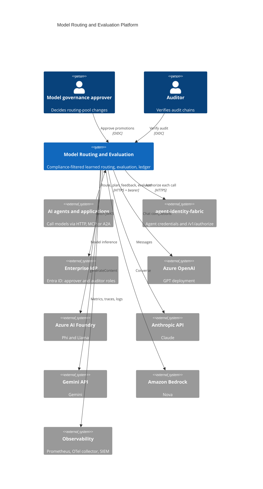
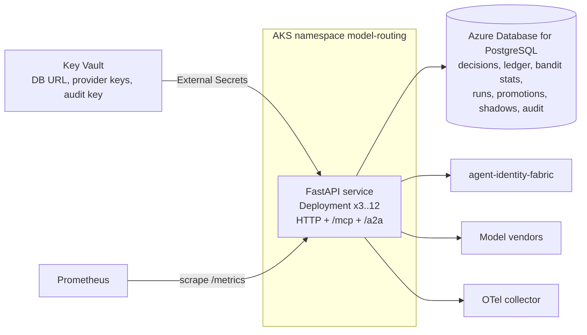
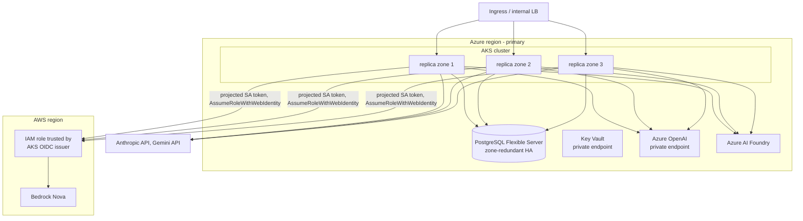

# Architecture

## Business problem

Enterprises now buy foundation model access from several vendors at once:
GPT through Azure OpenAI, Claude from Anthropic, Gemini from Google, Nova
through Amazon Bedrock, and open-weight Llama and Phi through Azure AI
Foundry. Each differs in quality per task, latency, price and, critically, in
the contracts that govern it: which jurisdiction processes the data, whether
a Business Associate Agreement covers it, whether prompts are retained.

Without a routing layer, every application team hard-codes one vendor. That
leaves three problems unsolved:

1. **Compliance is enforced by convention.** A team can send restricted data
   to an endpoint without a BAA, or EU personal data to a US region, and
   nothing stops it.
2. **Model choice is not evidence-based.** Teams pick a model once and never
   learn that a cheaper one passes their task, or that a vendor's quality
   regressed.
3. **Spend is invisible until the invoice.** Nobody can attribute token cost
   to a task family, a calling agent or an evaluation programme.

This platform puts one governed decision point in front of every model call.
Hard constraints remove every provider that may not see the data; a learned
router chooses among the rest; every outcome feeds back into the router; and
evaluation evidence plus human approval are required to change which
providers a task family may use at all.

## System context (C4 level 1)



## Containers (C4 level 2)



The service is stateless apart from PostgreSQL: bandit statistics are additive
counters, evaluation runs and promotions are rows, and each replica writes its
own audit chain keyed by pod name. That makes it a plain Deployment with a
Horizontal Pod Autoscaler (ADR-0005).

## Components (C4 level 3)

| Layer | Module | Responsibility |
|---|---|---|
| API | `api.app`, `api.routes`, `api.schemas` | HTTP contract, OAuth-style errors, correlation IDs, security headers, metrics middleware |
| Integrations | `integrations.mcp_server`, `integrations.a2a` | MCP tools (stateless streamable HTTP) and A2A Agent Card / JSON-RPC |
| Application | `application.routing_service` | Plan, route, feedback, shadow comparison |
| Application | `application.evaluation_service` | Offline runs, judge calibration, promotions with evidence gates |
| Application | `application.reports`, `application.access` | Family reports; agent authorization and human authentication for every channel |
| Routing | `routing.compliance`, `routing.bandit`, `routing.router`, `routing.config` | Hard filters, Thompson sampling and utility, agentic-core router subclass, family configuration |
| Evaluation | `evaluation.graders`, `judge`, `calibration`, `harness`, `bradley_terry`, `statistics`, `golden` | Grading, LLM-as-judge, calibration, offline harness, ranking, statistics, golden-set loading |
| Domain | `domain.models`, `domain.evaluation`, `domain.stats`, `domain.ports`, `domain.errors` | Value objects, sufficient statistics, ports, errors |
| Security | `security.identity`, `security.jwt` | Identity-fabric client, local and fabric authorizers, enterprise OIDC, JWKS caching |
| Infrastructure | `infrastructure.database` | SQLAlchemy Core repositories, additive bandit store, append-only audit sink |
| Runtime | `runtime.container` | Composition root built from settings |

Shared kernel (agentic-core v0.1.0): provider adapters (`AnthropicProvider`,
`OpenAICompatibleProvider` for Azure OpenAI and Azure AI Foundry,
`GeminiProvider`, `BedrockConverseProvider`), `ModelRouter`, retry and circuit
breaker, `PolicyEngine`, `AuditLog`, `ContentGuard`, structured logging and
GenAI telemetry.

## Sequences

### Routing a request

```mermaid
sequenceDiagram
  participant A as Agent
  participant S as Routing service
  participant F as Identity fabric
  participant P as Governance policy
  participant C as Compliance filter
  participant B as Bandit store
  participant G as ContentGuard
  participant R as ModelRouter (agentic-core)
  participant V as Vendors
  participant L as Ledger / audit
  A->>S: POST /v1/route (task, messages, classification, constraints) + bearer
  S->>F: POST /v1/authorize action=model-routing:invoke
  F-->>S: allow (agent, delegation chain, policy digest)
  S->>P: model-routing:invoke on task-family (purpose_of_use)
  P-->>S: allow / deny / require_approval
  S->>C: pool, classification, task, residency, BAA, cost ceiling
  C-->>S: eligible providers + exclusion reasons
  S->>B: load arm statistics for the family
  S->>S: sample quality, latency, cost per arm; order by utility
  S->>G: inspect input (injection, secrets, PII redaction)
  S->>R: generate(request) with planned order
  loop planned providers
    R->>V: call provider (retry, breaker)
  end
  V-->>R: response
  R-->>S: response + attempts
  S->>G: inspect output (credentials, PII)
  S->>B: observe latency, cost, schema quality; failures as quality 0
  S->>L: decision record (digests only), ledger entry, route.completed event
  S-->>A: answer, provider, candidates, exclusions, attempts, cost
  opt sampled and within daily shadow budget
    S->>R: same request to a compliance-eligible shadow provider
    S->>R: pairwise judge (independent provider, both orders)
    S->>B: relative quality for shadow and primary arms
    S->>L: shadow result, shadow ledger entries, shadow.compared event
  end
```

Failure handling: no eligible provider returns 422 `no_eligible_provider` with
the exclusion list; input blocked returns 400 `security_violation`; all
providers failed returns 503 and records quality 0 for each failed provider;
output blocked returns 502 `output_blocked` after charging the call to the
ledger and recording quality 0.

### Offline evaluation, judge calibration and ranking

```mermaid
sequenceDiagram
  participant A as Evaluator agent
  participant S as Evaluation service
  participant C as Compliance filter
  participant H as Harness
  participant R as ModelRouter
  participant J as Judge provider
  participant D as Database
  A->>S: POST /v1/judges/calibrations (judge, rubric, human-scored items)
  S->>J: score each item on the rubric
  S->>S: weighted kappa, Spearman, isotonic map; calibrated if kappa and n meet thresholds
  S->>D: store calibration
  A->>S: POST /v1/evaluations (golden set, providers, pairwise)
  S->>C: providers and judges cleared for the set's classification
  S->>S: estimate cost; governance (deny above budget)
  S-->>A: 202 run_id
  par each case x provider (bounded concurrency)
    H->>R: planned order = [provider] (no failover)
    H->>H: guard, grade (exact / regex / JSON Schema / judge)
  end
  opt pairwise
    H->>J: compare outputs A/B and B/A, judge excluded from contestants
    H->>H: Bradley-Terry fit, case bootstrap intervals
  end
  S->>D: results, summary; offline prior into bandit family arms
  A->>S: GET /v1/evaluations/{run_id}
```

### Routing-pool promotion

```mermaid
sequenceDiagram
  participant A as Agent (requester)
  participant S as Evaluation service
  participant P as Governance policy
  participant H as Approver (human)
  A->>S: POST /v1/promotions (family, provider, add, run_id, justification)
  S->>S: evidence gate: run completed, same family, min cases, min pass rate, calibrated judge
  S->>P: routing-pool:change (evidence_ok)
  P-->>S: require_approval
  S-->>A: 201 status=pending (audited)
  H->>S: POST /v1/promotions/{id}/decision (enterprise OIDC, approver role)
  S->>S: approver != requester; re-check evidence against the current pool
  S-->>H: approved (audited); provider joins the pool for routing
```

## Deployment view



- Replicas spread across zones with topology spread constraints; the PDB keeps
  two available; the HPA scales from 3 to 12 on CPU.
- Workload identity: an Azure user-assigned identity federated with the AKS
  service account reads Key Vault and calls Azure OpenAI. Nova is reached
  without static AWS keys: the pod gets a projected service-account token with
  audience `sts.amazonaws.com` and assumes the IAM role created by
  `deployments/terraform/aws`, whose trust policy names the AKS OIDC issuer.
- `deployments/terraform/aws` and `deployments/terraform/gcp` provision the
  same platform dependencies (database, KMS, secret manager, workload identity)
  for EKS and GKE deployments.

## Data

| Store | Data | Classification | Retention |
|---|---|---|---|
| `routing_decisions` | Family, provider, model, candidates, exclusions, attempts, input and output SHA-256 digests, tokens, cost, latency, quality | INTERNAL | Per records policy (default 1 year) |
| `cost_ledger` | Reference, kind, family, provider, model, caller, tokens, cost | INTERNAL | 7 years (financial records) |
| `bandit_stats` | Additive sufficient statistics per arm | INTERNAL | Life of the deployment |
| `evaluation_runs`, `evaluation_results` | Run metadata, summaries, golden-set outputs (truncated to 8,000 characters) | Golden-set classification | Life of the evidence (promotions reference runs) |
| `judge_calibrations` | Metrics and isotonic map, no item text | INTERNAL | Life of the deployment |
| `promotions` | Requests, evidence, decisions | INTERNAL | 7 years |
| `shadow_results` | Outcome, providers, cost, latency | INTERNAL | 1 year |
| `audit_events` | Signed hash chains per replica (append-only trigger) | CONFIDENTIAL | 7 years |

Prompts and model answers from routed traffic are never persisted (ADR-0006).

## Cost and scalability

Cost is configuration multiplied by vendor-reported token counts. For a
provider with contracted input price `p_in` and output price `p_out` (USD per
million tokens):

- routed request: `cost = (in_tokens * p_in + out_tokens * p_out) / 1e6`
- planning estimate (cost strategy and cost ceilings):
  `in_tokens ~ chars/4 + 1`, `out_tokens ~ max_tokens * expected_output_ratio`
- shadow spend per day: `rate * requests * mean(shadow cost + 2 * judge cost)`,
  capped by `MRE_SHADOW_DAILY_BUDGET_USD`
- offline run estimate: `sum over providers and cases of the routed estimate +
  judge calls * judge estimate`, where judge calls are
  `cases * providers` for judge-graded sets plus `cases * C(providers, 2) * 2`
  for pairwise ranking; runs estimated above the governance budget are refused.

The learned router reduces cost only where the family's utility weights say
cost matters; the weights live in `configs/routing.yaml` and are reviewed like
code.

Scalability: request handling is stateless and I/O bound. Per routed request
the service performs one bandit read (one query per family), a handful of
inserts and additive updates, and the model call. Bandit updates are
commutative increments, so replicas never coordinate. PostgreSQL is the
scaling limit; the routing tables are append-mostly and indexed by family and
time.

## MCP integration

`/mcp` serves the official `mcp` SDK (`MCPServer`, stateless streamable HTTP,
JSON responses). Tools:

| Tool | Input | Output | Authorization action |
|---|---|---|---|
| `route_completion` | `RouteInput` (task, prompt, system, classification, residency, requires_baa, max_cost_usd, max_tokens, strategy, purpose_of_use) | `RouteResult` | `model-routing:invoke` |
| `plan_route` | `RouteInput` | `RoutePlan` | `model-routing:plan` |
| `list_providers` | none | `ProviderList` | `provider:read` |
| `family_report` | family, days | `FamilyReport` | `report:read` |

Each tool reads the caller's bearer token from the request, authorizes it
exactly as the HTTP API does (identity fabric or local policy), writes an
`mcp.tool_call` audit event, then runs the same application service. Host
header validation (DNS-rebinding protection) is enabled when
`MRE_MCP_ALLOWED_HOSTS` is set.

## A2A communication design

- **Agent Card** at `/.well-known/agent-card.json`: protocol version 0.3.0,
  `url` = `MRE_PUBLIC_URL/a2a`, JSON-RPC transport, skills
  `route-completion` and `family-report`, security scheme HTTP bearer (JWT
  issued by agent-identity-fabric).
- **`POST /a2a`** accepts JSON-RPC 2.0 `message/send`. Text parts form the
  prompt; an optional data part carries `task`, `classification`,
  `constraints`, `max_tokens`, `purpose_of_use`, `strategy`, or selects
  `{"skill": "family-report", "family": "...", "days": 7}`.
- Responses are A2A `Message` objects with a text part (answer or Markdown
  report) and a data part (decision id, provider, model, cost; or the report).
- Authentication failures are HTTP 401/403; business errors are JSON-RPC
  errors (`-32000` with `data.error`), malformed calls `-32600`, unknown
  methods `-32601`, invalid params `-32602`.
- Delegation: when an orchestrator delegates to this service with an RFC 8693
  token, the fabric returns the delegation chain, which is recorded in every
  audit event.

## Observability

- Metrics (own registry, `/metrics`): `mre_http_request_duration_seconds`,
  `mre_route_decisions_total`, `mre_route_failures_total`,
  `mre_compliance_exclusions_total`, `mre_model_latency_seconds`,
  `mre_model_cost_usd_total`, `mre_model_tokens_total`,
  `mre_guard_blocks_total`, `mre_feedback_total`,
  `mre_shadow_comparisons_total`, `mre_shadow_in_flight`,
  `mre_evaluation_runs_total`, `mre_authorization_decisions_total`,
  `mre_promotions_total`.
- Traces: FastAPI instrumentation plus agentic-core `ModelTelemetryObserver`
  (GenAI semantic conventions: `gen_ai.system`, `gen_ai.usage.*`), exported
  over OTLP when `MRE_OTLP_ENDPOINT` is set.
- Logs: JSON with correlation IDs (`X-Correlation-ID` echoed), sensitive keys
  scrubbed.
- Alerts: `configs/prometheus/alerts.yaml`; dashboard:
  `configs/grafana/model-routing-evaluation.json`.

## CI/CD

`ci.yml`: quality (Python 3.12 and 3.13: ruff, black, mypy strict, bandit,
contract drift, all test suites with a 90% coverage gate),
integration-postgres, deploy-artifacts (Helm lint, required-values failure
check, kubeconform, Terraform fmt and validate for three clouds, Trivy config
scan), container (build, smoke test as uid 10001, Trivy image scan, Syft SBOM,
Grype gate) and Semgrep. `release.yml` on a `v*.*.*` tag re-runs the quality
gate, checks the tag against the package and chart versions, pushes the image
with provenance attestation and SBOM to GHCR, pushes the Helm chart to GHCR
OCI and creates the GitHub release.

## Cloud reference implementation (Azure)

| Concern | Azure service | Terraform |
|---|---|---|
| Runtime | AKS with workload identity and OIDC issuer | cluster is a prerequisite |
| Database | PostgreSQL Flexible Server, private, TLS required | `azurerm_postgresql_flexible_server` |
| Secrets | Key Vault (RBAC, private endpoint, network deny) | `azurerm_key_vault` |
| GPT | Azure OpenAI account and deployment, private endpoint, local auth for the api-key adapter | `azurerm_cognitive_account`, `azurerm_cognitive_deployment` |
| Identity | User-assigned identity, federated credential for the service account, Key Vault Secrets User and Cognitive Services OpenAI User roles | `azurerm_user_assigned_identity`, `azurerm_federated_identity_credential` |
| Nova | Bedrock in AWS via cross-cloud federation | `deployments/terraform/aws` |

## Acceptance criteria

1. No request is ever served by a provider that fails a hard filter
   (`tests/security/test_routing_attacks.py::test_residency_never_violated`,
   `test_baa_required_for_restricted`).
2. RESTRICTED requests without a purpose of use are refused by policy.
3. A provider that consistently scores worse receives a shrinking share of
   learned traffic (`tests/e2e/test_http_lifecycle.py::test_learned_routing_converges_on_quality`).
4. Provider outages fail over within the planned order and open circuit
   breakers (`tests/chaos`).
5. A routing pool changes only with passing evidence and an approval by a
   different human (`test_requester_cannot_approve_own_promotion`,
   `test_agent_token_cannot_approve`).
6. Every decision, refusal and state change is in a signed audit chain that
   `GET /v1/audit/verify` reports intact.
7. Every model call appears in the ledger with tokens and cost.
8. A fresh clone passes `make check` with no keys or services.
